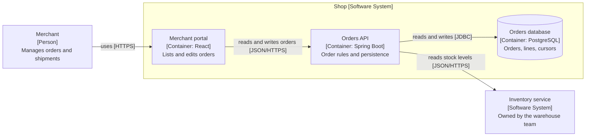
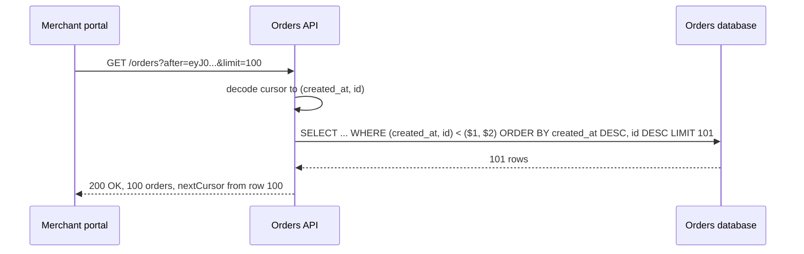

# Diagrams that communicate and prose that gets read: C4, sequence diagrams, and technical writing

> **In one sentence:** A diagram communicates when the reader knows what level they are looking at (C4 gives four: system context, containers, components, code), every box says what it is and what technology it runs on, every arrow says what flows and how, and the source lives in the repository as text; prose communicates when it leads with the conclusion, uses one idea per sentence and one topic per paragraph, and is laid out so a reader who skims the headings and first sentences still gets the message.

**Why it matters:** The architecture diagram on the wiki is a cloud of unlabelled boxes and arrows at four different levels of abstraction, drawn in a tool nobody has a licence for, and nobody has updated it since the person who drew it left. The design document that should have taken ten minutes to approve took three meetings because the decision was in paragraph nine. Senior engineers are judged more on these two skills than on any framework, because they are how decisions travel beyond the person who made them.

## The idea

**C4.** Simon Brown's model is four zoom levels over the same system, each for a different audience:

| Level | Shows | Boxes are | Audience |
|---|---|---|---|
| 1. System context | your system as one box, the people who use it, the systems it talks to | people and software systems | everyone, including non-technical |
| 2. Container | the deployable units inside your system (a web application, an API, a database, a message broker; not Docker containers specifically) and how they communicate | containers | developers and operations |
| 3. Component | the major building blocks inside one container and their dependencies | components (a module, a group of classes behind an interface) | developers on that container |
| 4. Code | classes inside one component | classes | rarely drawn; generate from the IDE if needed |

Most systems need levels 1 and 2 and a level 3 for the one or two containers that are complex. The model is notation-independent; what it insists on is that every element carries a name, a type (`[Person]`, `[Container: Spring Boot]`), and a one-line description, and that every arrow has a label saying what and how (`reads stock from [JSON/HTTPS]`). A legend, a title that says which level this is, and no mixing of levels on one diagram. C4 also defines supplementary diagrams, of which the *dynamic* diagram (numbered arrows showing one scenario) and the *deployment* diagram (containers mapped onto infrastructure) are the ones teams use.

**Sequence diagrams.** For one scenario through several participants, in time order: a request, a saga, a login flow. They answer "what happens, in what order, and who waits for whom", which a static diagram cannot. Keep one scenario per diagram, name the participants as the containers or components from the C4 diagrams so the two sets of pictures use one vocabulary, and show the failure path separately rather than with branching on the same picture.

**Diagrams as code.** Text in the repository, rendered on demand: Mermaid (rendered natively by GitHub and most wikis), PlantUML with the C4-PlantUML macros, or the Structurizr DSL, which defines the model once and renders every C4 level from it. Text diffs in pull requests, gets reviewed with the code it describes, and stays next to the ADR that explains it (item 9.2). The cost is layout: automatic layout is sometimes ugly, and you accept that in exchange for a diagram that is still correct next year.

**Technical writing.** Google's course and every style guide agree on the mechanics, and they are mechanical enough to apply in an editing pass:

- 1.1 Lead with the point. The first sentence of the document says what it concludes or asks for; the first sentence of each paragraph says what the paragraph is about. A reader who stops anywhere has the most important part.
- 1.2 One idea per sentence, one topic per paragraph. Long sentences hide the subject; split them.
- 1.3 Active voice with a concrete subject: "the order service calls the inventory API", not "the inventory API is called". Passive voice hides who does what, which is exactly what a design document needs to say.
- 1.4 Strong verbs. "The cache reduces p99 latency to 40 ms" rather than "the cache is responsible for the reduction of latency".
- 1.5 Define terms the first time, then use the same term every time. Synonyms read as different things.
- 1.6 Lists for parallel items, tables for comparisons, prose for arguments.
- 1.7 Write for the skimmer. Headings that state conclusions ("Keyset pagination replaces offset pagination"), not labels ("Pagination"). Bold the decision. Put details and alternatives after the recommendation, not before.
- 1.8 Cut. Every "basically", "in order to", "it should be noted that", and "very" goes. If a sentence survives without a word, the word goes.

## Example: one system at two C4 levels, one scenario, and a paragraph before and after

Level 2, container diagram, in Mermaid. Each box carries its name, type and technology; each arrow carries what and how:

Level 1 would collapse the `shop` subgraph into one box and keep the merchant and the inventory service. Level 3 would open `api` and show `OrderController`, `PlaceOrderService`, `JpaOrderRepository` and `InventoryClient`, with the ports between them (item 7.2).

The scenario "list the next page of orders" as a sequence diagram, using the same participant names:

Fetching `limit + 1` rows to know whether a next page exists is the kind of detail a sequence diagram makes visible and a container diagram should not contain.

A paragraph from a design document, before:

> It should be noted that in the current implementation, pagination of the orders list is being performed using offset-based parameters, and it has been observed that for pages deep into the result set the response time degrades significantly due to the fact that the database must scan and discard all preceding rows, which is problematic for partners who scan the complete set and has also been seen to result in duplicate and skipped records when new orders are being inserted during the scan.

After:

> Offset pagination makes deep pages slow and unreliable. Page 5,000 of `GET /orders` takes 2.1 s because PostgreSQL reads and discards 500,000 rows first. Partners who scan the whole set also see duplicates and gaps when orders are inserted mid-scan. We propose keyset pagination (section 3).

The second version leads with the conclusion, has a measured number instead of "significantly", uses active voice with named subjects, and tells the skimmer where the decision is. It is 55 words instead of 95.

## Pitfalls

- Mixed levels. A diagram with a person, a Kubernetes cluster, a `UserService` class and a Kafka topic on it is at four levels at once and tells nobody anything.
- Unlabelled arrows. An arrow between two boxes means "something happens"; "publishes OrderPlaced [Kafka]" means something.
- The one diagram that shows everything. Draw several small diagrams, each answering one question, rather than one poster.
- Diagrams in a drawing tool nobody else has. If it is not text in the repository or at least an exported SVG next to the document, it will rot.
- Sequence diagrams with `alt` and `loop` blocks nested three deep. That is code drawn as a picture; split the scenarios.
- Boxes named after technologies ("Kafka", "Redis") rather than what they are for ("Order events [Kafka]", "Session cache [Redis]"). Technology is the annotation, not the name.
- Documents that build up to the conclusion like a detective story. Reviewers read the first paragraph and the headings; put the answer there.
- Mixing "we might", "we could", "we should" and "we will" in one document. Say which parts are decided and which are open, in separate sections.

## Check yourself

1. Which C4 level does a diagram belong to if it shows a load balancer, two instances of the orders API, and PostgreSQL with a replica? What is that diagram actually called, and what is the difference from a container diagram?
2. Rewrite "The validation of incoming requests is performed by a filter that was introduced in order to ensure that malformed payloads are rejected before reaching the controllers" following rules 1.3, 1.4 and 1.8. Count the words before and after.
3. A colleague's design document has the decision in its last section, after six pages of analysis. Describe the restructuring you would suggest, section by section, without removing any content.
4. When is a sequence diagram the wrong picture, and what replaces it in each case: a system's dependencies; an aggregate's invariants; a state machine for order status?

## Go deeper

- [C4 model](https://c4model.com/) · the four levels, the notation checklist and the supplementary diagrams, by the model's author.
- [Mermaid](https://mermaid.js.org/) · syntax for flowcharts and sequence diagrams, with a live editor; GitHub renders these fences directly.
- [Google: Technical Writing Courses](https://developers.google.com/tech-writing) · "Technical Writing One" takes an afternoon and covers every rule in this note with exercises.
- [Malte Ubl: Design Docs at Google](https://www.industrialempathy.com/posts/design-docs-at-google/) · what a design document contains, which is where the writing rules above get applied.
- [ADR GitHub organisation](https://adr.github.io/) · where the diagrams and the prose end up: next to the decision they explain.

---

Part of [Architecture & Craft](../README.md) · items 9.3, 9.5
